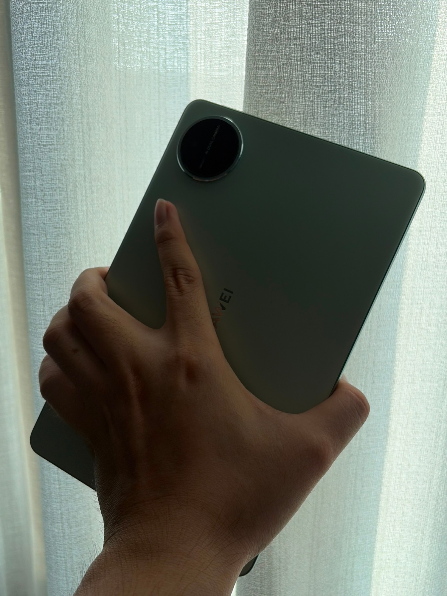
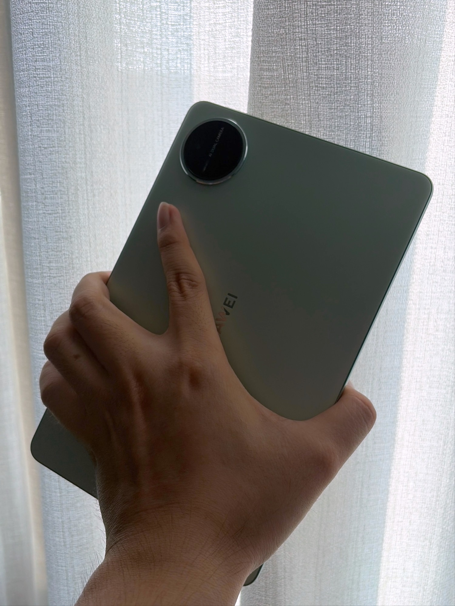
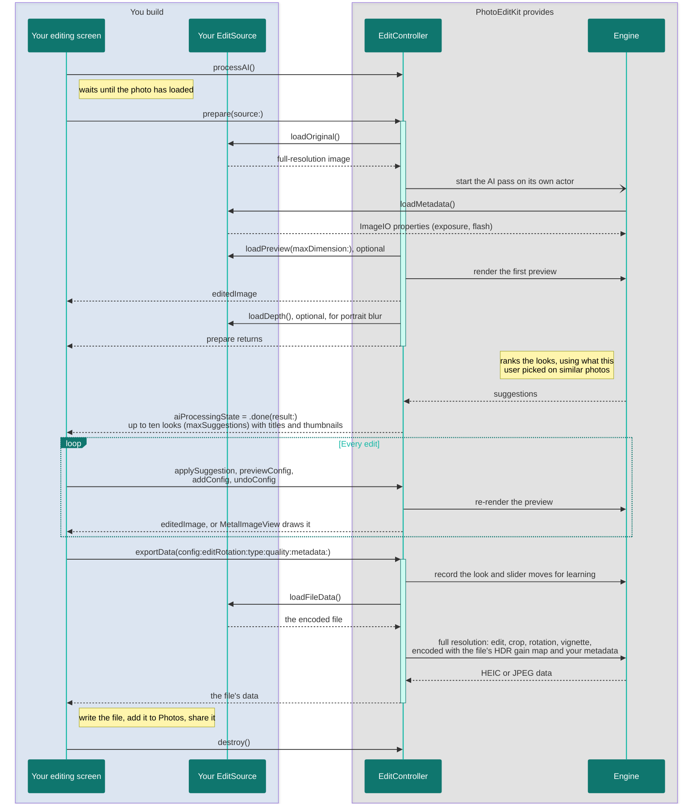
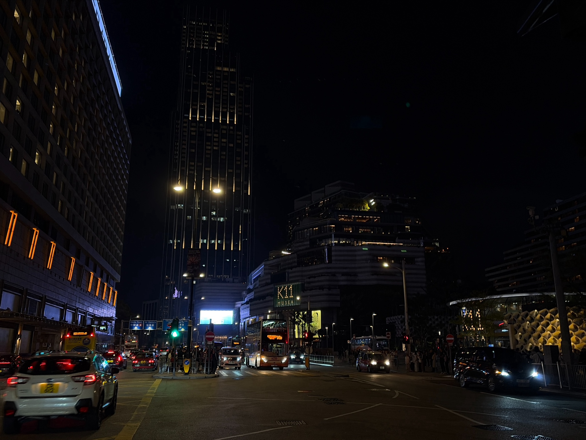
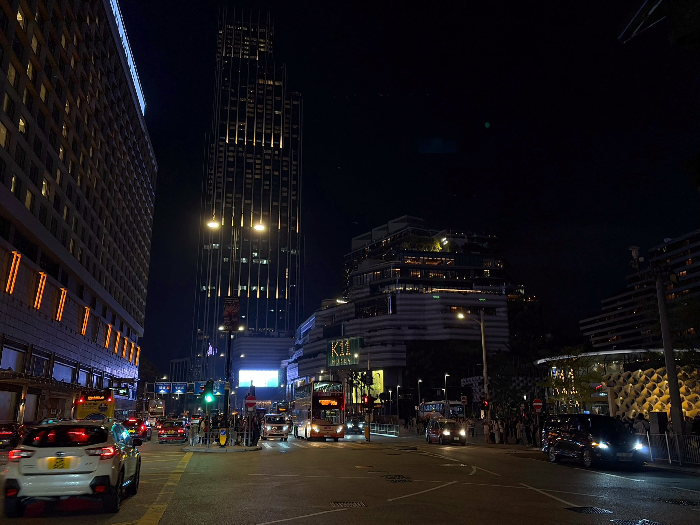
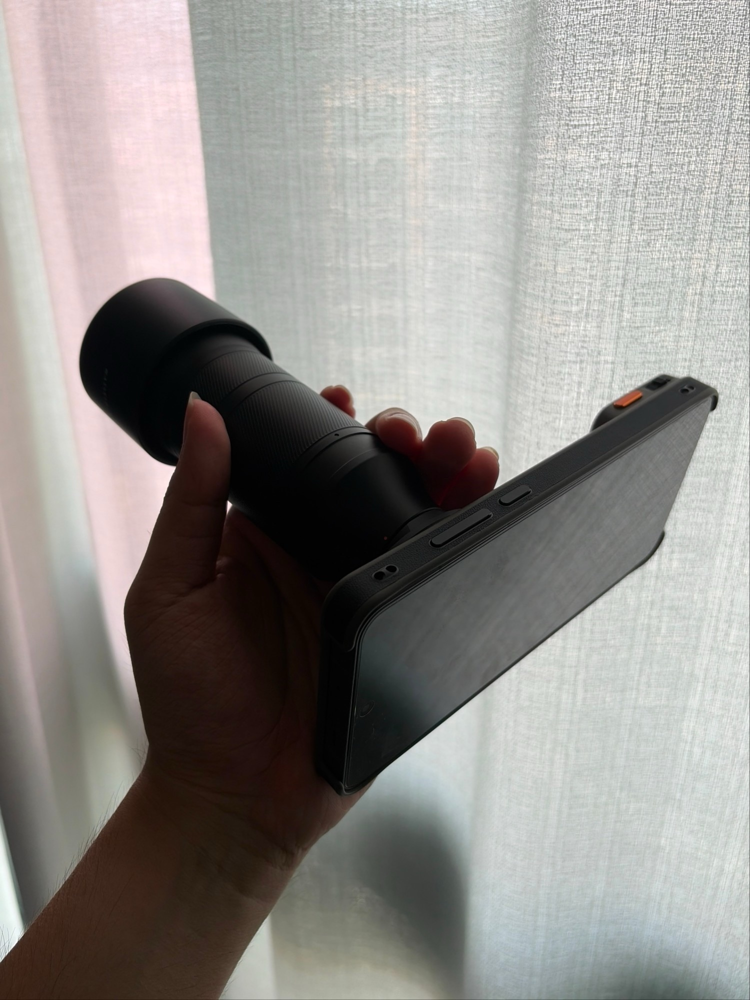
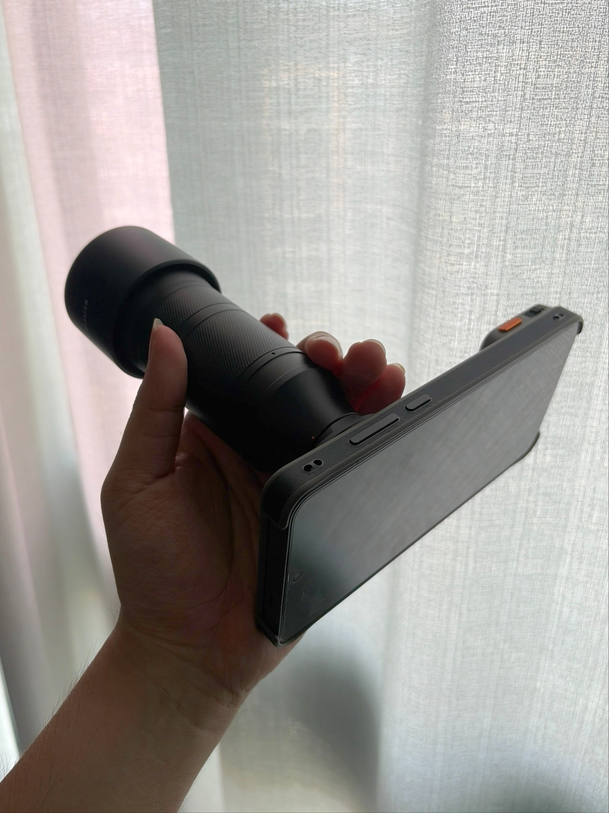

# PhotoEditKit

[](#swift-package-manager)
[](#requirements)
[](#requirements)
[](#privacy)

**One call gives a photo the edit it needs, entirely on the device.**

PhotoEditKit is a photo editing toolkit for iOS and macOS apps. It looks at a photo
(exposure, colour cast, faces, subject, grain, scene) and suggests edits you
can show as a picker or apply straight away. It also includes the Core Image
pipeline that renders them and an editor model for building your own editing
screen.

| Original | AI edit |
| :---: | :---: |
|  |  |
|  |  |

[More examples](#examples)

To try it on a phone, [AutoEdit – Smart Photo Editor](https://apps.apple.com/sg/app/autoedit-smart-photo-editor/id6818664461) on the App Store
is built on PhotoEditKit: pick a photo and it opens on the AI's best edit,
with the other suggested looks one tap away.

```swift
if let config = AIPostProcessingHelper.topSuggestion(for: photo, metadata: properties) {
    let edited = CIImage(cgImage: photo).applyingEditConfig(config)
}
```

## Features

- **AI edit suggestions.** Up to ten ranked looks per photo (you can set the
  limit), each with a
  title and a thumbnail, or a single best edit. A photo that's already good
  gets `nil` rather than a style it didn't ask for.
- **Corrections and styles.** Brighten, Lift Shadows, Recover Highlights,
  Warm Up, Cool Down, Clean Up and more fix problems. Vivid, Punch, Matte,
  Muted, Soft and others are styles, sized to each photo. [See every recipe](#the-recipes).
- **Natural faces.** Every look keeps skin hue and saturation natural.
- **Learns on the device.** Suggestions adapt to which looks the user picks
  and how they adjust them, separately for each kind of photo. [How it works](#learning-from-saves).
- **RAW aware.** Can match the camera's own rendering of a RAW and build the
  other looks on top of it.
- **A full editor model.** `EditController` handles loading, live previews,
  undo/redo, crop, rotation, portrait blur and full-resolution export. You
  build the UI; `MetalImageView` draws the live preview on the GPU.
- **HDR kept.** Exports keep the iPhone's HDR gain map.
- **Live Photos kept.** A Live Photo's movie is edited with the photo and
  saved paired with it.
- **Style matching.** Makes one photo's tones match a reference photo.
- **Private by design.** No network requests, no models to download, no
  account. Safe to use in app extensions.
- **Localized** in English, Chinese and other languages.

## Contents

- [How it fits into your app](#how-it-fits-into-your-app)
- [Examples](#examples)
- [Requirements](#requirements)
- [Installation](#installation)
- [Quick start: let the AI edit a photo](#quick-start-let-the-ai-edit-a-photo)
- [Edits: `EditConfig`](#edits-editconfig)
- [Rendering an edit](#rendering-an-edit)
- [AI suggestions](#ai-suggestions)
- [The recipes](#the-recipes)
- [Building an editor with `EditController`](#building-an-editor-with-editcontroller)
- [Exporting with HDR](#exporting-with-hdr)
- [Keeping Live Photos live](#keeping-live-photos-live)
- [Matching a style](#matching-a-style)
- [Threading](#threading)
- [Localization](#localization)
- [Privacy](#privacy)
- [Support](#support)
- [License](#license)

## How it fits into your app

PhotoEditKit does the image work. Your app supplies the photo, the screens
and the saving. This is one editing session, call by call:



A RAW adds two more calls to your source: `loadRawExtras` while loading and
`developRaw` while exporting.

| You build | PhotoEditKit provides |
|---|---|
| An [`EditSource`](#1-provide-the-photo) that loads the photo from your library or files | Loading, the AI analysis and [suggestions](#ai-suggestions) with thumbnails |
| The [editing screen](#3-edit): picker, sliders, buttons | [`EditController`](#building-an-editor-with-editcontroller): previews, undo/redo, crop, rotation, portrait blur, and [`MetalImageView`](#drawing-the-preview-on-the-gpu-with-metalimageview) to draw the preview |
| [Saving](#4-export-and-finish): writing the file, adding it to Photos, sharing | The full-resolution render, encoded with the [HDR gain map](#exporting-with-hdr) and metadata, and [learning](#learning-from-saves) from each save |

For a single automatic edit with no editing screen, skip `EditController`
and `EditSource`: one `AIPostProcessingHelper` call and one render are enough.
See the [quick start](#quick-start-let-the-ai-edit-a-photo).

## Examples

Each photo on the left, and on the right the edit the AI suggested for it.

| Original | AI edit |
| :---: | :---: |
|  |  |
|  |  |
|  |  |
|  |  |
|  |  |
|  |  |

## Requirements

- iOS 17.6 or later, or macOS 15 or later
- Xcode with the Swift compiler this release was built with, or a newer one.
  The framework ships a module interface, so a newer compiler can read it; an
  older one can't.

### On macOS

The API is the same on both platforms; images are `PlatformImage`, which is
`UIImage` on iOS and `NSImage` on macOS. `NSImage` applies a photo's EXIF
orientation when it loads it, so hand it over as loaded. The examples below
use `UIImage`; on a Mac read `NSImage` in its place.

## Installation

PhotoEditKit ships as a binary `PhotoEditKit.xcframework`.

### Swift Package Manager

In Xcode, choose **File → Add Package Dependencies…**, enter

```
https://github.com/8kdesign/PhotoEditKit
```

and add the **PhotoEditKit** library to your app target.

To declare the dependency in your own `Package.swift`:

```swift
.package(url: "https://github.com/8kdesign/PhotoEditKit", from: "1.0.0")
```

### Manual

1. Download `PhotoEditKit.xcframework.zip` from the
   [latest release](https://github.com/8kdesign/PhotoEditKit/releases/latest),
   unzip it and copy `PhotoEditKit.xcframework` into your project folder.
2. In your app target, go to **General → Frameworks, Libraries, and Embedded
   Content**, click **+**, then **Add Other… → Add Files…** and pick the
   `.xcframework`.
3. Set it to **Embed & Sign**. For an app extension that also uses it, add it
   to the extension as **Do Not Embed**; the app embeds it.

If the app crashes at launch with `Library not loaded: @rpath/PhotoEditKit.framework`,
the framework isn't embedded. Check step 3.

## Quick start: let the AI edit a photo

```swift
import ImageIO
import PhotoEditKit

guard let source = CGImageSourceCreateWithURL(photoURL as CFURL, nil) else { return }
let properties = CGImageSourceCopyPropertiesAtIndex(source, 0, nil) as? [String: Any]

// A small upright copy is all the AI needs, and much faster than full size.
let options = [
    kCGImageSourceCreateThumbnailFromImageAlways: true,
    kCGImageSourceCreateThumbnailWithTransform: true,
    kCGImageSourceThumbnailMaxPixelSize: 512,
] as CFDictionary
guard let small = CGImageSourceCreateThumbnailAtIndex(source, 0, options) else { return }

// Off the main thread: this measures the photo.
if let config = AIPostProcessingHelper.topSuggestion(for: small, metadata: properties),
   let original = CIImage(contentsOf: photoURL, options: [.applyOrientationProperty: true]) {
    let edited: CIImage = original.applyingEditConfig(config)
} else {
    // The photo is already good. Keep it as it is.
}
```

`metadata` is the photo's ImageIO properties
(`CGImageSourceCopyPropertiesAtIndex`). It's optional, but pass it when you
have it: the exposure values in it are how the AI tells a photo that is dark
on purpose (a night street, a lamp-lit room) from one that came out too dark.
Without them, more night photos get brightened.

For the same photo to get the same suggestions every time, give the AI the
original file's properties, not those of a copy. Exports, screenshots and
images saved from a canvas usually drop the EXIF. In testing, losing it changed
the top suggestion on about 1 photo in 7, more than any other difference.
Above about 2048 pixels on the long edge, the photo's size makes little
difference to `suggestions(for:)`. Smaller copies read as less grainy, so they
can get a different list.

## Edits: `EditConfig`

An `EditConfig` describes one complete edit: slider values, crop and rotation.
The AI produces them, the editor keeps a history of them, and the pipeline
renders them.

```swift
let config = EditConfig(properties: [
    .exposure: 0.2,
    .contrast: 0.1,
    .saturation: -0.3,
    .vignette: 0.4,
])
```

Each value is an **offset from neutral**, so `0` (or leaving the key out)
means "unchanged", whatever the underlying filter treats as neutral. To scale
an edit up or down, multiply its values. Leave `.aspectratio` and `.rotation`
alone when you do, because half a crop isn't a gentler crop:

```swift
var properties = config.properties
for (key, value) in properties where key != .aspectratio && key != .rotation {
    properties[key] = value * 0.5
}
let gentler = EditConfig(properties: properties, crop: config.crop, editRotation: config.editRotation)
```

### Settings and ranges

| `EditSettingType` | Range | |
|---|---|---|
| `.exposure` | −0.5 … 0.5 | |
| `.brightness` | −0.5 … 0.5 | |
| `.contrast` | −0.5 … 0.5 | |
| `.shadow` | −1 … 1 | positive lifts shadows |
| `.highlight` | −1 … 0 | negative recovers highlights |
| `.saturation` | −1 … 1 | |
| `.temperature` | −1 … 1 | positive is warmer |
| `.tint` | −1 … 1 | positive is more magenta, negative greener |
| `.shadowWarmth` | −1 … 1 | warms or cools the shadows only |
| `.sharpness` | −1 … 1 | positive sharpens; negative flattens fine detail into painted patches |
| `.noiseReduction` | 0 … 1 | |
| `.vignette` | −1 … 1 | |
| `.boostRed` `.boostOrange` `.boostYellow` `.boostGreen` `.boostCyan` `.boostBlue` `.boostPurple` `.boostMagenta` | −1 … 1 | colour mixer: saturation of one colour band |
| `.hueRed` … `.hueMagenta` (same eight bands) | −1 … 1 | colour mixer: turns a band's colours toward its neighbours; positive goes on round the wheel (red toward orange, blue toward purple) |
| `.luminanceRed` … `.luminanceMagenta` (same eight bands) | −1 … 1 | colour mixer: lightens or darkens a band's colours, leaving greys alone |
| `.rotation` | −45 … 45 | degrees, straightening |
| `.depth` | 0 … 40 | background blur ("Background Blur"); offer it only when `EditController.hasDepth` |

`type.getSetting()` returns an `EditSetting` with the localized name, an SF
Symbol and the range (`minValue`, `maxValue`), which is everything you need to
build a slider.

Read a value with `config.value(of: .saturation)` (0 when untouched), and make
a change with `setting.getEditConfig(amount)`, which is ready for
`previewConfig` and `addConfig`. A change made this way carries its setting, so
consecutive changes to one slider merge into a single undo step:

```swift
let saturation = EditSettingType.saturation.getSetting()
let current = editor.currentConfig.value(of: .saturation)       // e.g. 0.2
editor.addConfig(saturation.getEditConfig(0.1))                  // now 0.3
```

`availableEditSettings`, `colorMixerSettings` and `rotationSettings` list the
settings in display order. The colour mixer has hue, saturation and luminance
for each of eight bands (`ColorBand`): `colorMixerSettings(.hue)` lists one
channel, and `band.setting(.luminance)` gives one band's slider. Every
setting is a slider: there are no hidden settings a suggestion can carry that
your editor can't show.

Crop is `config.crop`, a rect in normalized coordinates, where `(0, 0, 1, 1)` is
the whole image. Quarter turns and flips are `config.editRotation` (`EditRotation`).

`EditConfig` is immutable. `[config1, config2].combine()` merges configs by
adding their values, the same way the editor stacks changes.

## Rendering an edit

**Core Image.** Applies the colour and tone settings, and the vignette, but
not crop or rotation:

```swift
let output: CIImage = input.applyingEditConfig(config)
```

When you're rendering a preview that is smaller than the photo, pass
`renderScale` (preview size ÷ full size). Sharpening and noise reduction work
in pixels, so without it a small preview looks sharper and grainier than the
export.

**Full render, including crop and rotation.** Use `PostProcessingHelper`. Turn
the vignette off in the first step and apply it last, so it is centred on the
cropped photo rather than the original frame:

```swift
// On LogicActor
let helper = PostProcessingHelper(image: cgImage)
helper.applyEditConfig(config: config, includeVignette: false)
helper.applyRotationCropConfig(config: config)
helper.applyFullRotateAndFlip(editRotation: config.editRotation)
helper.applyVignette(config: config)
let result: CGImage? = helper.toCGImage()
```

`PostProcessingHelper.renderedEdit(of:config:rawRecovery:)` is a shortcut for the
colour and tone part alone.

## AI suggestions

All AI is reached through `AIPostProcessingHelper`. The calls are synchronous
and take a noticeable amount of time on full-resolution photos, so run them off
the main thread (for example inside `Task.detached { … }`).

### One edit

```swift
AIPostProcessingHelper.topSuggestion(for: cgImage, metadata: properties) -> EditConfig?
```

Returns the edit the photo most needs, or `nil` when it doesn't need one. It
never crops or rotates. A copy of about 512 px on the long edge is enough, and
much faster than full resolution. A `CGImage` carries no orientation, so turn
it upright first.

This is not the same as the first of `suggestions(for:)`:

- If the look that ranks first would barely change the photo, `topSuggestion`
  returns `nil` rather than the next look down. A good photo stays as it is
  instead of getting a style it didn't ask for.
- It doesn't measure grain, since a small copy hides it. Its edit never adds
  noise reduction on that account. Use `suggestions(for:)` on the full-size
  photo when grain matters.

### A list of suggestions

```swift
let suggestions: [EditSuggestion] = AIPostProcessingHelper.suggestions(for: uiImage, metadata: properties)
for suggestion in suggestions {
    suggestion.title      // LocalizedStringResource, e.g. "Brighten"
    suggestion.config     // EditConfig to apply
    suggestion.thumbnail  // small rendered preview, ready for a picker
}
```

Returns up to ten suggestions, best first; pass `maxSuggestions:` for another
limit (at least 1; `EditController.maxSuggestions` with the controller). A
smaller limit keeps the best of the same list, in the same order. Pass `offerOriginal: true` to let
the list lead with an **Original** suggestion (no edit) when no look improves
on the photo as it is; it is off by default. With `EditController`, set
`offersOriginalSuggestion` before `processAI()`. Pass `includeThemes: true` to
also get [themes](#themes) that suit the photo; they come after the other
suggestions, outside the limit, with `isTheme` set, and never change which other
suggestions are offered or their order. Off by default; with `EditController`,
set `offersThemeSuggestions`. Pass `disabledLooks:` (a set of `AILook`, such
as `[.trueColor]`) to leave looks out; the next best take their place. With
`EditController`, set `disabledLooks`; `topSuggestion(for:metadata:disabledLooks:)`
takes it too. Pass the photo at full resolution,
which is what the grain measurement needs; its `imageOrientation` is honoured.
It took about 0.2 s on a 12 MP photo in the simulator; budget more on older
devices. If the calling `Task` is
cancelled, it stops at the next stage and returns an empty array.

If you develop RAW files yourself, pass the camera's embedded preview. The
AI then offers an **Original** suggestion that matches the camera's own
rendering, and builds every other suggestion on top of it:

```swift
let raw = AIPostProcessingHelper.RawContext(cameraReference: embeddedPreview, rawRecovery: nil)
AIPostProcessingHelper.suggestions(for: develop, raw: raw, metadata: properties)
```

### Faster first photo

The first photo after launch is the slowest. The AI models have to load, and
the GPU compiles each look's filters the first time it draws them. Call
`prewarm()` when your app launches to do that while the user is still choosing
a photo:

```swift
@main
struct MyApp: App {
    init() {
        AIPostProcessingHelper.prewarm()
    }
    // …
}
```

It returns at once and works in the background at low priority. Calling it
again does nothing. If a photo is opened before it finishes, that photo's
suggestions wait for one small step of it at most. On a Mac, the first 12 MP
photo's suggestions took about 110 ms after `prewarm()` instead of 190–300 ms.

### Scene

```swift
let scene: AIScene? = AIPostProcessingHelper.classifyScene(cgImage)
scene?.title   // localized name
scene?.icon    // SF Symbol name
```

The scenes are `people`, `animals`, `food`, `object`, `indoor`, `city`, `sky`,
`nature` and `light`. It returns `nil` when the photo couldn't be classified.

### Learning from saves

Suggestions adapt to the person using your app. When a photo is exported with
`EditController.renderForExport` after its suggestions were generated,
PhotoEditKit records what happened: which looks were offered, which one was
on the photo, and how far each slider was then moved from it. Later
suggestions use those records in two ways:

- **Order.** Looks the user picks move up the list. Looks shown above the one
  they picked, and the top looks when they save with none, move down.
- **Values.** If the user keeps adjusting a look the same way, for example
  lowering Vivid's saturation, that look starts closer to where they leave it.

Learning depends on the kind of photo. Each record is matched by how similar
its photo is to the new one, using a summary of the analysis: brightness,
contrast, colour, grain, faces and scene. Only close matches count, and
nothing changes until there are a few of them. A habit on food photos doesn't
change landscapes, and a change made after one look applies only to that
look.

What is learned stays small and inside the rules. A look can move a few
places in the list, and each slider at most 15% of its range. Limits on grain,
skin tone, clipping and minimum edit size still apply afterwards. A look's
direction never flips: Cool Down can become neutral, but never warm.

The records are used by `suggestions(for:)` and `topSuggestion(for:)`. Only
`renderForExport` adds them, so an app that uses just the `AIPostProcessingHelper`
calls gets the recipes unchanged.

```swift
AIPostProcessingHelper.learnedEditCount         // how many saves are recorded
AIPostProcessingHelper.resetLearnedPreferences() // forget them all
```

Consider offering the reset in your settings screen.

## The recipes

Each suggestion comes from one of a fixed set of recipes. The AI uses only
the recipes that suit the photo, sizes each one to it, and puts the one the
photo most needs first. The same recipe can come out differently on two photos: Vivid on a
landscape leans into its greens, Vivid on a street at night into its lights.

There are two kinds. **Corrections** fix something about the photo: its
exposure, its colour or its noise. **Styles** are a matter of taste. When a
photo needs fixing, corrections come first.

### Corrections

| Recipe | What it does |
|---|---|
| Original | RAW photos only. Matches the camera's own rendering of the RAW, which is usually livelier than a plain develop. Every other recipe on a RAW starts from it. |
| Clean Up | Reduces grain and noise, and leaves tone and colour alone. |
| Balance Light | RAW photos only. Opens up the shadows and brings back the highlights together, for backlit or high-contrast scenes. |
| Brighten | Lifts a photo that came out too dark. |
| Deepen | The opposite of Brighten: richer blacks and more contrast for a photo that looks grey or washed out, without lightening it. |
| Recover Highlights | Brings back detail in bright areas such as a sky. Ranks lower when what's blown out is away from the subject, such as a white border or a lit window, since a JPEG has no detail left there to bring back. A RAW that still holds the detail keeps its place. |
| Lift Shadows | Opens up dark areas without brightening the rest of the photo, including a subject that's dark against a bright sky or window. |
| Warm Up | Takes a blue or cold colour cast back to neutral. |
| Cool Down | Takes an orange or yellow colour cast back to neutral. |
| True Color | For daylight photos where people and buildings in shade have turned blue and milky under a bright sky. Warms the shade and restores its contrast. Also takes the edge off a strong warm cast without making the photo cold, and takes a mild green or magenta tint off the photo's whites, such as a white object that reads lavender under mixed light. Strong tints, and tints at night, are left alone as part of the scene. Puts back what the correction itself disturbs: warm colours keep their hue as a warm cast comes out, a warmed sky stays blue, leaves keep their light, and a face that ends up too pink, too yellow or too red is brought back to natural skin. |

Warm Up and Cool Down correct a cast; they don't add one. A photo with
balanced colour gets neither.

### Styles

| Recipe | What it does |
|---|---|
| Crisp | Sharper detail with a little more contrast. |
| Punch | Stronger contrast with a moderate colour boost. Keeps the photo's warmth: it doesn't warm or cool it. Deepens a daylight blue sky. |
| Pop | Brighter and punchier at once, for a light-coloured subject in a dim room, such as a glass of juice under a lamp. The subject's own colours are lifted further than the rest of the photo. Not offered on photos with a lot of white. |
| Vivid | Richer, more saturated colour, led by the colours the photo is about. Deepens a daylight blue sky rather than oversaturating it, and turns the yellowish greens of sunlit leaves toward true green. |
| Muted | Quieter colour overall, while the main subject keeps its own. Takes out more colour the more colourful the photo is. |
| Matte | A faded, film-print style: softened blacks, gentler colour and a light vignette. Fades more on a contrasty photo, less on a flat one. |
| Soft | A gentle, warm finish with low contrast. |
| Spotlight | Darkens the edges to draw the eye to the middle of the photo. Leaves colour alone. |

### Themes

Themes restyle a photo as something else rather than improve it. They are only
offered with `includeThemes: true`, always after the corrections and styles.

| Theme | What it does |
|---|---|
| Manga | A hand-painted anime look: bright, open shadows, soft highlights, light cyan anime skies and clean leaf greens, and fine detail flattened into painted patches (negative `.sharpness`). The sky turns less cyan when hazy blue mountains or water share its colour. City, nature and sky photos in daylight only, not sunsets or night. |
| B&W | Black and white, with contrast, highlights and shadows set for the photo; a warm sunset sky is darkened as a blue filter does on film, through the colour mixer's luminance. Only offered on photos with strong contrast, or a city lit up at night. |
| Film | A print from colour negative film: muted colour (greens most of all, turned toward olive, and blues toward teal), strong contrast that follows the photo's own light, highlights rolled off, a little warmth and green tint, and a very subtle vignette. Slightly darker than the photo, but eases off on faces and on a subject that is already dark. Not offered on night or dark photos. |

### Every recipe

- **Faces:** every recipe, corrections included, is adjusted so skin keeps a
  natural hue and saturation, and faces are brightened slightly without
  brightening the rest of the photo. A face lit by coloured light from
  different sides, as on a stage, is left as lit. A clearly blurred face near the middle of the
  frame is sharpened slightly (except in Clean Up and Soft); no other
  sharpening is added unless the photo itself measures soft (Crisp). Faces
  smaller than about 2% of the frame count for less.
- **Subject and focus:** the AI works out where the subject is from faces,
  where the eye is drawn and what's in focus. Brighten judges exposure partly
  by the subject. On a photo with a shallow depth of field, Brighten, Lift
  Shadows and Recover Highlights judge mostly by the part in focus, so a
  blurred dark background or blown-out bokeh counts for little.
- **Grain:** on a night or clearly overexposed photo, a recipe that would make
  grain more visible, such as a shadow lift, adds noise reduction for it.
  Noise reduction leaves fine texture (bark, fabric, hair) alone. A lift that
  the grain would make too costly is cut back, or the recipe is dropped.
- **Small edits are skipped:** a recipe that would barely change the photo isn't
  offered, so a good photo can get only a few suggestions.
- **Similar looks are spread out:** when two suggestions would look nearly
  the same, the second moves down the list.

## Building an editor with `EditController`

`EditController` is an `ObservableObject` that runs a complete editing
session: it loads the photo, renders previews as edits change, keeps
undo/redo, runs the AI suggestions and renders the final export. You provide
the photo through an `EditSource` and build whatever UI you like on top.

### 1. Provide the photo

`EditController` doesn't know about the photo library or files. It reads
everything through your `EditSource`. An ordinary photo needs only three
methods; the RAW and depth ones have defaults.

```swift
// `nonisolated` because the editor calls the source from its own actor, not
// the main actor that new Xcode projects give every type by default.
// `@unchecked Sendable` because the source is shared with that actor: it's
// safe here since nothing changes after `init`.
nonisolated final class FileEditSource: EditSource, @unchecked Sendable {
    let data: Data
    let imageSource: CGImageSource

    init?(data: Data) {
        guard let source = CGImageSourceCreateWithData(data as CFData, nil) else { return nil }
        self.data = data
        self.imageSource = source
    }

    // The full-resolution photo. A UIImage's imageOrientation is honoured, so
    // you don't need to redraw a photo that carries an EXIF orientation. On
    // macOS, NSImage(data:) applies it already.
    @LogicActor func loadOriginal() async -> EditSourceImage? {
        UIImage(data: data).map { EditSourceImage(image: $0, isDevelopedRaw: false) }
    }

    // The ImageIO properties. The AI reads exposure information from them.
    func loadMetadata() async -> [String: Any]? {
        CGImageSourceCopyPropertiesAtIndex(imageSource, 0, nil) as? [String: Any]
    }

    // The encoded file, so an export can keep its HDR gain map.
    func loadFileData() async -> (data: Data, orientation: CGImagePropertyOrientation)? {
        (data, orientation)
    }

    private var orientation: CGImagePropertyOrientation {
        let properties = CGImageSourceCopyPropertiesAtIndex(imageSource, 0, nil) as? [String: Any]
        let value = properties?[kCGImagePropertyOrientation as String] as? UInt32
        return value.flatMap(CGImagePropertyOrientation.init(rawValue:)) ?? .up
    }
}
```

For a RAW, implement `isRaw`, `loadRawExtras` and `developRaw`; for depth
(portrait blur), `loadDepth` and `defaultBlurRadius`. `loadPreview(maxDimension:)`
is optional too: implement it if you can make a small copy more cheaply than
shrinking the original, for example if you already have one on screen.

A portrait photo keeps its depth beside the image in the file. Read it in
`loadDepth`, turned upright by the orientation it was saved with:

```swift
@LogicActor func loadDepth() async -> (data: AVDepthData, orientation: Int32)? {
    for type in [kCGImageAuxiliaryDataTypeDisparity, kCGImageAuxiliaryDataTypeDepth] {
        guard let info = CGImageSourceCopyAuxiliaryDataInfoAtIndex(imageSource, 0, type) as? [String: Any],
              let depth = try? AVDepthData(fromDictionaryRepresentation: info) else { continue }
        let description = info[kCGImageAuxiliaryDataInfoDataDescription as String] as? [String: Any]
        let saved = (description?["Orientation"] as? NSNumber)?.int32Value
        return (depth, saved ?? Int32(orientation.rawValue))
    }
    return nil
}
```

`defaultBlurRadius` is the blur the photo opens with. Leave it out (the default
is 0) for the photo to open as it was taken, with the blur there to add.

#### Actor isolation

The editor calls your source from its own actors, so the source mustn't be
tied to the main actor:

- In a project with **Default Actor Isolation** set to **MainActor** (the
  default for new Xcode projects), mark the class `nonisolated` as above.
  Without it, Swift 5 mode warns and Swift 6 mode refuses to compile.
- The source is handed to the editor's actor, so it has to be `Sendable`. A
  class that doesn't change after `init` can declare `@unchecked Sendable`;
  one that does needs a lock around what changes.

### 2. Run the session

```swift
// On the main actor, e.g. in your view model
let editor = EditController()

// Show `editor.editedImage` (a preview-sized UIImage, NSImage on macOS) in your UI. It's set by
// the time `prepare` returns, and updates after every edit.
// Observe `editor.aiProcessingState` for suggestions.

editor.processAI()                        // ask for suggestions; runs once the photo has loaded
Task { await editor.prepare(source: source) }
```

`aiProcessingState` moves from `.pending` to `.loading` to
`.done(result: [EditSuggestion])`, or to `.unavailable` when there are no
suggestions to offer.

#### Drawing the preview on the GPU with `MetalImageView`

By default every slider tick renders the preview into a bitmap and publishes
it as `editedImage`. That copies the whole preview from the GPU to the CPU and
back on every frame. For smoother sliders, have the controller hand over the
edit as an unrendered Core Image chain instead, and draw it with
`MetalImageView`, a SwiftUI view that renders straight into the screen's
drawable:

```swift
let editor = EditController()
editor.rendersPreviewOnGPU = true         // set before `prepare`

// In your SwiftUI view:
@ObservedObject var editor: EditController

var body: some View {
    if let chain = editor.previewCIImage {
        MetalImageView(image: chain)
            .aspectRatio(chain.extent.size, contentMode: .fit)
    } else if let image = editor.editedImage {
        Image(uiImage: image).resizable().scaledToFit()
    }
}
```

- `previewCIImage` is the full preview, crop, straightening and vignette
  included, and is published on every change. Quarter turns and flips are
  left to your view; see [below](#quarter-turns-and-flips). It's `nil` until
  the photo has loaded, and always `nil` with `rendersPreviewOnGPU` off.
- `editedImage` is still kept up to date for anything that needs a bitmap,
  such as a share sheet, but only once edits pause for a
  quarter of a second (and immediately for the first frame).
- Size the view to the image's aspect ratio, as above. The image is fitted and
  centred; anything left over is transparent.
- For a view you zoom with a transform (`scaleEffect`), pass `detailScale` so
  it draws at more than screen resolution: `MetalImageView(image: chain,
  detailScale: zoom > 1 ? 4 : 1)`. It never draws past the image's own
  pixels, so a large value means full resolution. iOS only; macOS ignores it.
- Colour matches `editedImage` and the export: the view renders with the same
  settings, into Display P3.
- To show the original while a compare button is held, lay
  `sourcePreviewImage` over the Metal view rather than removing it, so letting
  go doesn't wait for a new view's first frame.

It's a `UIViewRepresentable` (`NSViewRepresentable` on macOS). In UIKit, host
it in a `UIHostingController`.

### 3. Edit

The configs you pass to `previewConfig` and `addConfig` are **changes**, added
on top of the edit so far. `addConfig(EditConfig(properties: [.exposure: 0.1]))`
twice gives an exposure of 0.2.

| Call | |
|---|---|
| `applySuggestion(_:automatic:)` | apply an AI suggestion; `nil` removes it. `appliedSuggestionID` tells you which one is on. Pass `automatic: true` when your app applied it rather than the user, e.g. opening on the top suggestion, so keeping it counts for less when [learning](#learning-from-saves). See below for how it treats earlier edits |
| `previewConfig(_:)` | show a change while a slider is moving, without adding it to the history. Each call replaces the previous preview |
| `confirmPreviewConfig()` | commit the previewed change when the slider is released |
| `addConfig(_:)` | commit a change in one step |
| `undoConfig()` / `redoConfig()` | with `canUndo()` / `canRedo()`; see below for keeping buttons up to date |
| `historyCount` | how many steps undo can go back. To stop undo at a point (e.g. right after a suggestion was applied), read it there and allow undo only while it's larger |
| `hasEdits()` | whether anything has been changed |
| `showOriginalImage` | a flag for your UI, e.g. while a "compare" button is held. The controller doesn't swap images itself: show `sourcePreviewImage` while it's `true` |
| `currentConfig` | the edit as it stands. Read-only: change it through the calls above |
| `setAspectRatio(_:)` | switch the crop ratio and crop the photo to it, as one step. `aspectRatio` reads the current one |
| `editRotation` | the quarter turns and flip, read-only; see [below](#quarter-turns-and-flips) |
| `hasDepth` | whether the photo has depth, so `.depth` (background blur) can be offered. Set once `prepare` has loaded it, just after the first preview |

#### Cropping with `CropView`

`CropView` is a ready-made crop screen that works the way the Photos app
crops. Show it in place of the edited photo while the user crops or
straightens, and switch back when they're done:

```swift
if isCropping {
    CropView(editor: editor)
} else {
    // the edited photo, as in step 2
}
```

- The crop sits centred and as large as the view allows, with the rest of
  the photo dimmed around it. Around the photo, your own background shows.
- Drag a corner or an edge to resize the crop; when the finger lifts, it
  grows back to fill the view and zooms the photo with it. Drag inside to
  move the photo under the crop, and pinch to zoom. On iOS, lifting one
  finger of a pinch carries on as a move with the other.
- It follows the edit as it is set elsewhere: the straightening (`.rotation`),
  the quarter turns and flips, and the aspect ratio from `setAspectRatio(_:)`.
  A resize keeps to that ratio.
- Each gesture is previewed while it moves and committed as one undo step
  when it ends, so undo and redo work as for a slider.
- It draws `prerotatedImage`, the photo with its colour and tone edits but
  before any cropping, so give it the room the edited photo had.

#### Quarter turns and flips

A quarter turn or a flip is a change like any other:

```swift
// Turn 90° clockwise, or flip left to right. Each tap turns or flips again.
editor.addConfig(EditConfig(properties: [:], editRotation: .ninety, actionType: .fullRotation))
editor.addConfig(EditConfig(properties: [:], editRotation: .originalFlip, actionType: .fullRotation))
```

The previews (`editedImage`, `previewCIImage`) leave them out, so the photo
doesn't have to be rendered again when it turns: apply `editRotation` to the
view that shows them. A turned photo's width and height swap, so lay it out at
its turned size and rotate inside that:

```swift
let rotation = editor.editRotation
let turns = rotation.isNeedSizeChange()
photo
    .frame(width: fitted.width, height: fitted.height)     // its own shape
    .scaleEffect(x: rotation.isFlipped() ? -1 : 1, y: 1)
    .rotationEffect(.degrees(rotation.getDegree()))
    .frame(width: turns ? fitted.height : fitted.width,     // the turned shape
           height: turns ? fitted.width : fitted.height)
```

`CropView` and the export apply them themselves.

#### Suggestions replace earlier slider work

Applying a suggestion sets every colour and tone setting to the suggestion's
own value, so slider changes made *before* it are replaced rather than added
to. A second suggestion replaces the first. Crop, rotation and background blur
are kept. It all goes on the history as one step: a single undo brings back
the edit as it was, and applying a suggestion clears redo.

Slider changes made *after* a suggestion are separate steps on top of it.

#### Keeping undo and redo buttons up to date

Every edit, undo and redo fires the controller's `objectWillChange`. A SwiftUI
view that observes the controller re-reads `canUndo()` and `canRedo()`
automatically:

```swift
@ObservedObject var editor: EditController

Button("Undo") { editor.undoConfig() }.disabled(!editor.canUndo())
```

In UIKit, subscribe to `objectWillChange` and read the values on the next turn
of the main run loop. `objectWillChange` fires just before the change, so
reading them inside the sink gives the old values:

```swift
cancellable = editor.objectWillChange
    .receive(on: RunLoop.main)
    .sink { [weak self] in
        guard let self else { return }
        undoButton.isEnabled = editor.canUndo()
        redoButton.isEnabled = editor.canRedo()
    }
```

### 4. Export and finish

```swift
let config = editor.currentConfig
let rotation = editor.editRotation
let metadata = await source.loadMetadata()
if let data = await editor.exportData(config: config, editRotation: rotation,
                                      type: .heic, quality: 0.9, metadata: metadata) {
    // A HEIC file with the original's HDR gain map and metadata.
    // Write it out, add it to Photos or share it.
}
editor.destroy()       // when the editing session ends
```

`type` is `.jpeg` or `.heic`; the defaults are `.jpeg` at 0.95. The metadata
is optional. When you pass it, it's corrected for the export: the photo is
marked upright, and the original's pixel size and colour profile are dropped
in favour of the new file's. Add your own tags, such as the TIFF software
name, before you pass it.

To encode the result yourself, call `renderForExport(config:editRotation:)`
instead. It returns the full-resolution `CGImage` and the HDR gain map, when
the original had one.

Both record the edit for [learning](#learning-from-saves), if the photo's
suggestions were generated. Calling them twice in one session, for example to
save and then share, records it once.

## Exporting with HDR

Photos taken on recent iPhones carry an HDR gain map. `EditController.exportData`
keeps it: the gain map is read from your source's `loadFileData()`, framed like
the edit and attached to the encoded file. When there's no gain map, or
attaching it fails, the image is encoded on its own, so you get a file either
way.

`HDRGainMap` is there for photos that don't go through `EditController`, or
when you call `renderForExport` and encode the result yourself:

```swift
let data = HDRGainMap.encode(rendered.image, gainMap: rendered.gainMap, type: .heic, quality: 0.9)
```

If you then copy the data into a `CGImageDestination` to add metadata, call
`HDRGainMap.copy(from:to:)` as well, because ImageIO leaves the gain map behind
when it copies an image. `HDRGainMap.read(from:orientation:)` reads the gain
map out of an image file.

## Keeping Live Photos live

A Live Photo is a photo and a short movie that Photos pairs by an identifier
both carry. Hand the movie to the editor through your source, and
`EditController.exportLivePhoto` renders it again with the same edit (tone,
colour, crop, straightening and quarter turns) and pairs it with the photo:

```swift
final class MySource: EditSource {
    // ...
    // The Live Photo's movie as a file, or nil for a still photo.
    func loadPairedVideo() async -> URL? { movieURL }
}

guard let export = await editor.exportLivePhoto(config: config, editRotation: rotation,
                                                type: .heic, quality: 0.9,
                                                metadata: await source.loadMetadata()) else { return }
let photoURL = /* write export.photo to a file */
try await PHPhotoLibrary.shared().performChanges {
    let request = PHAssetCreationRequest.forAsset()
    request.addResource(with: .photo, fileURL: photoURL, options: nil)
    if let video = export.video {
        request.addResource(with: .pairedVideo, fileURL: video, options: nil)
    }
}
// Then delete photoURL and export.video.
```

Give Photos both halves as **files**: it rejects a photo passed as `Data`
together with a movie passed as a file. `export.video` is nil when the source
has no movie, the movie couldn't be rendered, or the edit has a background blur
(the movie has no depth to blur by). The photo then comes without a pairing
identifier, so it saves as an ordinary photo. Every export strips the
original's identifier, because Photos rejects a photo that names a movie it
isn't saved with.

To get the movie from a `PhotosPickerItem` without asking for library access,
load it as a `PHLivePhoto` and copy out its `.pairedVideo` resource with
`PHAssetResourceManager`. Don't check the item's content types first: with the
current encoding, a Live Photo can list only its still's type.

If you encode the photo yourself, call `exportLivePhotoVideo(from:config:editRotation:identifier:)`
for the movie and put the same identifier in the photo's metadata with
`LivePhoto.metadata(_:pairedWith:)`. If Photos still refuses the pair,
`LivePhoto.removingPairing(from:)` gives you the photo without its identifier,
so you can save it on its own.

The movie is written as SDR HEVC at the edited frame size. An HDR Live Photo's
movie loses its HDR.

## Matching a style

`StyleMatcher` makes one photo's tones match a reference photo, or the average
of several:

```swift
// On LogicActor
guard let reference = StyleMatcher.statistics(for: referenceImage),
      let target = StyleMatcher.statistics(for: photo),
      let transform = StyleMatcher.transform(for: target, matching: reference),
      transform.isMeaningful else { return }
let matched = photo.applyingStyleTransform(transform)
```

Use `StyleMatcher.average(of:)` to combine several references into one.

## Threading

Calls are marked with the actor they run on, and can be awaited from anywhere:

- `LogicActor`, PhotoEditKit's own actor, for loading, rendering and export
  (`EditController.prepare`, `renderForExport`, `PostProcessingHelper`
  geometry, `StyleMatcher`, and your `EditSource`'s `loadOriginal`).
- `MainActor` for everything on `EditController` that changes the edit
  (`addConfig`, `applySuggestion`, `undoConfig`, …).

`EditController` runs its AI suggestions on a background actor of its own.

`AIPostProcessingHelper` and `applyingEditConfig` aren't tied to an actor. Call
them from wherever suits you, just not on the main thread for full-size images.

## Localization

Setting, recipe and scene names come back as `LocalizedStringResource`.

| Language | Code |
|---|---|
| English | `en` |
| Simplified Chinese | `zh-Hans` |
| Traditional Chinese | `zh-Hant` |
| Japanese | `ja` |
| Korean | `ko` |

iOS picks the framework's language to match your app's, so a language only
shows up if your app is localized in it too.

## Privacy

PhotoEditKit makes no network requests and collects nothing. Photos, metadata
and suggestions stay on the device. It doesn't download any models, so it
works offline from the first launch.

The one thing it writes to disk is the record used for [learning from
saves](#learning-from-saves): `Library/Application Support/PhotoEditKit/LearnedPreferences.json`
in your app's container. It holds no photos or thumbnails, only the photo
summary numbers, look names and slider values for at most the 500 latest
saves (under 0.5 MB). It is included in device backups like the rest of your
app's data. It is deleted with your app, or straight away by
`resetLearnedPreferences()`.

## Support

Found a bug, or a photo the AI edits badly? Please
[open an issue](https://github.com/8kdesign/PhotoEditKit/issues). For a bad
edit, attach the photo (or a copy at around 1024 px) and say which suggestion
looked wrong. Real photos are what the recipes are tuned on.

If PhotoEditKit is useful in your app, a ⭐ helps other developers find it.

## License

PhotoEditKit is free to use, including in commercial apps. It ships as a
binary and is not open source: you may not modify it, reverse engineer it, or
sell or redistribute it on its own. See [LICENSE](LICENSE) for the full terms.
